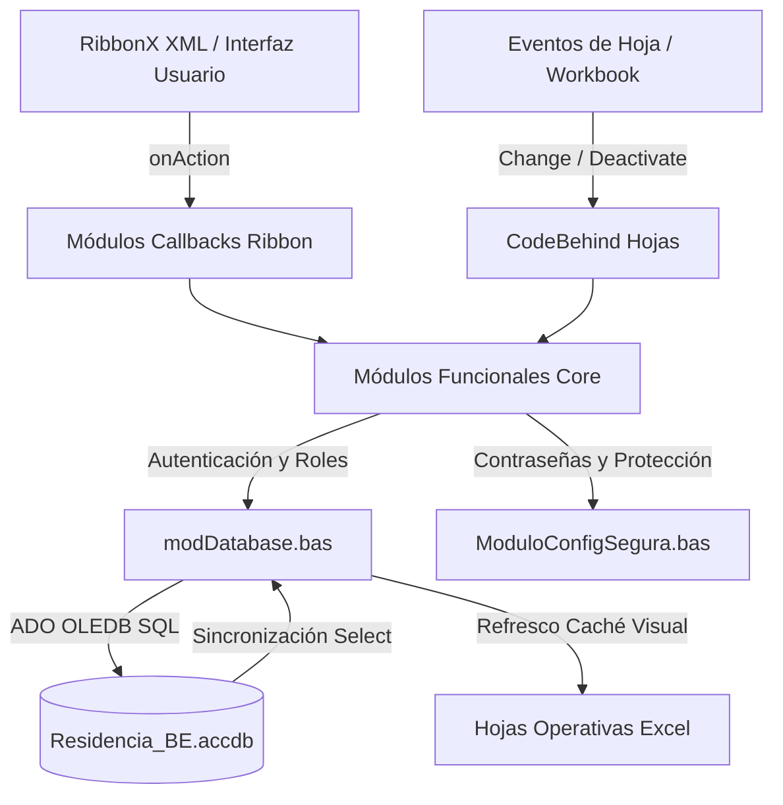

# Mapa de Dependencias y Grafo de Arquitectura — BDAS Multiusuario

> **Fecha de consolidación:** 17 de Octubre de 2026  
> **Libro Maestro:** `H:\ResidenciaBD\BDAS_Multiusuario.xlsm` (MD5: `9E9685D7F5F8E33B8A139EE4929AE543`)  
> **Base de Datos Backend:** `H:\ResidenciaBD\Residencia_BE.accdb` (MD5: `740739C2D02DD8D98F17C4DD75F09AD2`)

---

## 1. Arquitectura General del Sistema

El sistema opera bajo un modelo desacoplado de **Caché Visual en Excel + Persistencia Real en Access**:

---

## 2. Catálogo de Callbacks de la Cinta RibbonX (`customUI.xml`)

La cinta de opciones personalizada dispone de 2 pestañas principales con 69 acciones cableadas a macros VBA públicas:

### Pestaña 1: `GESTIÓN RESIDENCIAS ASTURIAS` (`id="gestionResidencia"`)

#### Grupo: GESTIÓN ALOJAMIENTOS (`id="Gijon"`)
| ID Botón | Etiqueta en Pantalla | Callback `onAction` | Módulo VBA Responsable | Propósito |
| :--- | :--- | :--- | :--- | :--- |
| `Button1` | Último Nº Orden | `IrUltimaCeldaVacia` | [BotonIrUltimaCeldaOrden.bas](file:///H:/ResidenciaApp/bdas-multiusuario/vba-modules/BotonIrUltimaCeldaOrden.bas) | Salta a la última celda con datos en la hoja activa |
| `Button2` | Filtrar solicitudes | `MostrarFilasPorIntervaloFechas` | [BotonFiltrarSolicitudesxFechas.bas](file:///H:/ResidenciaApp/bdas-multiusuario/vba-modules/BotonFiltrarSolicitudesxFechas.bas) | Filtro dinámico de reservas por fecha de estancia |
| `Button11` | Realizar búsqueda | `BusquedasResidencia` | [BusquedaDNIResidencias.bas](file:///H:/ResidenciaApp/bdas-multiusuario/vba-modules/BusquedaDNIResidencias.bas) | Abre formulario de búsqueda multicriterio por DNI/Nombre |
| `btnInsertarComentario` | Insertar Comentario | `ComentarioCeldaInsertar` | [MóduloComentarios.bas](file:///H:/ResidenciaApp/bdas-multiusuario/vba-modules/MóduloComentarios.bas) | Añade comentario enriquecido en celda seleccionada |
| `btnEliminarComentario` | Eliminar Comentario | `ComentarioCeldaBorrar` | [MóduloComentarios.bas](file:///H:/ResidenciaApp/bdas-multiusuario/vba-modules/MóduloComentarios.bas) | Borra comentario de celda |
| `BtnImprimirSobreGijon` | Sobre Gijón | `MostrarSobreGijon` | [BotonSobreGijon.bas](file:///H:/ResidenciaApp/bdas-multiusuario/vba-modules/BotonSobreGijon.bas) | Muestra y prepara la hoja `SOBRE GIJÓN` |
| `BtnImprimirSobreOviedo` | Sobre Oviedo | `MostrarSobreOviedo` | [BotonSobreOviedo.bas](file:///H:/ResidenciaApp/bdas-multiusuario/vba-modules/BotonSobreOviedo.bas) | Muestra y prepara la hoja `SOBRE OVIEDO` |

#### Grupo: CALENDARIOS (`id="Gijon2"`)
| ID Botón | Etiqueta | Callback `onAction` | Módulo VBA | Propósito |
| :--- | :--- | :--- | :--- | :--- |
| `ButtonActualizarGijon` | Actualizar Gijón | `ActualizarCalendarioGijon` | [BotonActualizarCalendarios.bas](file:///H:/ResidenciaApp/bdas-multiusuario/vba-modules/BotonActualizarCalendarios.bas) | Regenera calendario visual Gijón desde Access |
| `ButtonActualizarSoto` | Actualizar Soto | `ActualizarCalendarioSoto` | [BotonActualizarCalendarios.bas](file:///H:/ResidenciaApp/bdas-multiusuario/vba-modules/BotonActualizarCalendarios.bas) | Regenera calendario visual Soto desde Access |
| `ButtonActualizarOviedo` | Actualizar Oviedo | `ActualizarCalendarioOviedo` | [BotonActualizarCalendarios.bas](file:///H:/ResidenciaApp/bdas-multiusuario/vba-modules/BotonActualizarCalendarios.bas) | Regenera calendario visual Oviedo desde Access |
| `Button3` | Retroceder 5 días | `Retroceder5DiasDesdeFechaVisible` | [CalendarioRetroceder5dias.bas](file:///H:/ResidenciaApp/bdas-multiusuario/vba-modules/CalendarioRetroceder5dias.bas) | Desplaza vista de calendario -5 días |
| `btnPosicionarFecha` | Ir a Fecha Actual | `PosicionarFechaActual` | [PosicionarFechaActualCalendario.bas](file:///H:/ResidenciaApp/bdas-multiusuario/vba-modules/PosicionarFechaActualCalendario.bas) | Centra el scroll en la fecha de hoy |
| `Button5` | Avanzar 5 días | `Avanzar5DiasDesdeFechaVisible` | [CalendarioAvanzar5dias.bas](file:///H:/ResidenciaApp/bdas-multiusuario/vba-modules/CalendarioAvanzar5dias.bas) | Desplaza vista de calendario +5 días |
| `Button6` | Avanzar 10 días | `Avanzar10DiasDesdeFechaVisible` | [CalendarioAvanzar10dias.bas](file:///H:/ResidenciaApp/bdas-multiusuario/vba-modules/CalendarioAvanzar10dias.bas) | Desplaza vista de calendario +10 días |

#### Grupo: GESTIÓN ECONÓMICA (`id="GrupoFacturacion"`)
| ID Botón | Etiqueta | Callback `onAction` | Módulo VBA | Propósito |
| :--- | :--- | :--- | :--- | :--- |
| `BtnFacturacionMensualGijon` | Facturación mes Gijón | `MostrarFacturacionGijon` | [BotonFacturacionMes.bas](file:///H:/ResidenciaApp/bdas-multiusuario/vba-modules/BotonFacturacionMes.bas) | Abre hoja resumen de facturación mensual Gijón |
| `BtnFacturaHabitacionGijon` | Factura PAX Gijón | `MostrarFacturaPaxGijon` | [BotonFacturaPAX.bas](file:///H:/ResidenciaApp/bdas-multiusuario/vba-modules/BotonFacturaPAX.bas) | Prepara plantilla de factura individual Gijón |
| `BtnFacturacionMensualSoto` | Facturación mes Soto | `MostrarFacturacionSoto` | [BotonFacturacionMes.bas](file:///H:/ResidenciaApp/bdas-multiusuario/vba-modules/BotonFacturacionMes.bas) | Abre hoja resumen de facturación mensual Soto |
| `BtnFacturaHabitacionSoto` | Factura PAX Soto | `MostrarFacturaPaxSoto` | [BotonFacturaPAX.bas](file:///H:/ResidenciaApp/bdas-multiusuario/vba-modules/BotonFacturaPAX.bas) | Prepara plantilla de factura individual Soto |
| `BtnFacturacionMensualOviedo` | Facturación mes Oviedo | `MostrarFacturacionOviedo` | [BotonFacturacionMes.bas](file:///H:/ResidenciaApp/bdas-multiusuario/vba-modules/BotonFacturacionMes.bas) | Abre hoja resumen de facturación mensual Oviedo |
| `BtnFacturaHabitacionOviedo` | Factura PAX Oviedo | `MostrarFacturaPaxOviedo` | [BotonFacturaPAX.bas](file:///H:/ResidenciaApp/bdas-multiusuario/vba-modules/BotonFacturaPAX.bas) | Prepara plantilla de factura individual Oviedo |

#### Grupo: GESTIÓN SOLICITUDES (`id="GrupoSolicitudes"`)
| ID Botón | Callback `onAction` | Módulo VBA | Propósito |
| :--- | :--- | :--- | :--- |
| `BtnSolicitudesGijon` / `menu` | `BuscarPDFGijon` / `ConfigurarCarpetaGijon` | [GestionSolicitudesPDFGijon.bas](file:///H:/ResidenciaApp/bdas-multiusuario/vba-modules/GestionSolicitudesPDFGijon.bas) | Búsqueda y vinculación de archivos PDF de Gijón |
| `BtnSolicitudesSoto` / `menu` | `BuscarPDFSoto` / `ConfigurarCarpetaSoto` | [GestionSolicitudesPDFSoto.bas](file:///H:/ResidenciaApp/bdas-multiusuario/vba-modules/GestionSolicitudesPDFSoto.bas) | Búsqueda y vinculación de archivos PDF de Soto |
| `BtnSolicitudesOviedo` / `menu` | `BuscarPDFOviedo` / `ConfigurarCarpetaOviedo` | [GestionSolicitudesPDFOviedo.bas](file:///H:/ResidenciaApp/bdas-multiusuario/vba-modules/GestionSolicitudesPDFOviedo.bas) | Búsqueda y vinculación de archivos PDF de Oviedo |

#### Grupo: GESTIÓN LAVANDERÍA (`id="GrupoLavanderia"`)
| ID Botón | Callback `onAction` | Módulo VBA | Propósito |
| :--- | :--- | :--- | :--- |
| `BtnLavanderiaGijo` / `Historico` | `MostrarLavanderiaGijon` / `MostrarHistoricoLavanderiaGijon` | [BotonLavanderiaGijon.bas](file:///H:/ResidenciaApp/bdas-multiusuario/vba-modules/BotonLavanderiaGijon.bas), [BotonLavanderiaGijonHistorico.bas](file:///H:/ResidenciaApp/bdas-multiusuario/vba-modules/BotonLavanderiaGijonHistorico.bas) | Gestión activa e histórico lavandería Gijón |
| `BtnLavanderiaSoto` / `Historico` | `MostrarLavanderiaSoto` / `MostrarHistoricoLavanderiaSoto` | [BotonLavanderiaSoto.bas](file:///H:/ResidenciaApp/bdas-multiusuario/vba-modules/BotonLavanderiaSoto.bas), [BotonLavanderiaSotoHistorico.bas](file:///H:/ResidenciaApp/bdas-multiusuario/vba-modules/BotonLavanderiaSotoHistorico.bas) | Gestión activa e histórico lavandería Soto |
| `BtnLavanderiaOviedo` / `Historico` | `MostrarLavanderiaOviedo` / `MostrarHistoricoLavanderiaOviedo` | [BotonLavanderiaOviedo.bas](file:///H:/ResidenciaApp/bdas-multiusuario/vba-modules/BotonLavanderiaOviedo.bas), [BotonLavanderiaOviedoHistorico.bas](file:///H:/ResidenciaApp/bdas-multiusuario/vba-modules/BotonLavanderiaOviedoHistorico.bas) | Gestión activa e histórico lavandería Oviedo |

#### Grupo: HERRAMIENTAS (`id="customGroup1"`)
| ID Botón | Callback `onAction` | Módulo VBA | Nivel / Restricción |
| :--- | :--- | :--- | :--- |
| `btnRestaurarEventos` | `RestaurarEventosYEstados` | [EjecutarMacrosManual.bas](file:///H:/ResidenciaApp/bdas-multiusuario/vba-modules/EjecutarMacrosManual.bas) | Recuperación (`Application.EnableEvents = True`) |
| `btnLOGGijon/Soto/Oviedo` | `VisualizarLogGijon/Soto/Oviedo` | [BotonLOG.bas](file:///H:/ResidenciaApp/bdas-multiusuario/vba-modules/BotonLOG.bas) | Visualización de hojas LOG (Fase 1: Exclusivo ADMIN) |
| `ButtonBloq...` | `MostrarBloqueosGijon/Soto/Oviedo` | [BotonBloqueoHabitaciones.bas](file:///H:/ResidenciaApp/bdas-multiusuario/vba-modules/BotonBloqueoHabitaciones.bas) | Hojas de habitaciones bloqueadas |
| `ButtonActivarSolape...` | `AceptarSolapeGijon/Oviedo...` | [BotonesSolapes.bas](file:///H:/ResidenciaApp/bdas-multiusuario/vba-modules/BotonesSolapes.bas) | Autorización controlada de solapes de habitación |
| `ButtonVisualizarSolapes...` | `VerHojaSolapesAceptados...` | [BotonesSolapes.bas](file:///H:/ResidenciaApp/bdas-multiusuario/vba-modules/BotonesSolapes.bas) | Consulta de histórico de solapes |
| `BtnSeparacion...` | `CambiarSeparacionGijon/Soto/Oviedo` | [SeparacionDiasReservas.bas](file:///H:/ResidenciaApp/bdas-multiusuario/vba-modules/SeparacionDiasReservas.bas) | Configuración de margen de días entre reservas |
| `BtnOcultarHab...` | `GestionarHabitacionesGijon/Soto/Oviedo` | [ModuloGestionHabitaciones.bas](file:///H:/ResidenciaApp/bdas-multiusuario/vba-modules/ModuloGestionHabitaciones.bas) | Filtrado visual de habitaciones en calendario |
| `btnGestionarUsuarios` | `GestionarUsuarios` | [GestionarAccesoUsuarios.bas](file:///H:/ResidenciaApp/bdas-multiusuario/vba-modules/GestionarAccesoUsuarios.bas) | Altas, bajas y permisos de usuarios (ADMIN) |
| `btnFestivos` | `AsignarFestivo` | [BotonFestivos.bas](file:///H:/ResidenciaApp/bdas-multiusuario/vba-modules/BotonFestivos.bas) | Configuración de calendario de festivos |
| `btnInicioCalendario` | `EstablecerFechaInicio` | [CalendariosFechaInicio.bas](file:///H:/ResidenciaApp/bdas-multiusuario/vba-modules/CalendariosFechaInicio.bas) | Ajusta fecha base visual del calendario |
| `menuPlantillas` | `MostrarPlantillaGijon/Soto/Oviedo` | [AccesoPlantillas.bas](file:///H:/ResidenciaApp/bdas-multiusuario/vba-modules/AccesoPlantillas.bas) | Plantillas de concesión/resolución |
| `menuContrasenas` | `MostrarContrasenasGijon/Soto` | [BotonContraseñasAlojamientos.bas](file:///H:/ResidenciaApp/bdas-multiusuario/vba-modules/BotonContraseñasAlojamientos.bas) | Visualización de claves de alojamiento/WiFi |
| `MenuTarifas` | `MostrarTarifaUnidad` / `Descanso` | [BotonTarifasUnidadDescanso.bas](file:///H:/ResidenciaApp/bdas-multiusuario/vba-modules/BotonTarifasUnidadDescanso.bas) | Hojas maestras de tarifas |
| `BtnListaNegra` | `MostrarListaNegra` | [BotonListaNegra.bas](file:///H:/ResidenciaApp/bdas-multiusuario/vba-modules/BotonListaNegra.bas) | Consulta de personas no autorizadas |
| `btnImportarDatosGijonSoto` | `ImportarDatosGijonSotoOviedo_Click` | [BotonImportarGijonSotoOviedo.bas](file:///H:/ResidenciaApp/bdas-multiusuario/vba-modules/BotonImportarGijonSotoOviedo.bas) | Migración/sincronización masiva de datos |
| `btnBorradoParcialCeldas` | `BorradoParcialCeldas_Click` | [BorradoFilasHojasBDAS.bas](file:///H:/ResidenciaApp/bdas-multiusuario/vba-modules/BorradoFilasHojasBDAS.bas) | Limpieza de celdas visuales locales |
| `btnBorradoCeldas` | `BorrarDatosAlojamientoOptimizado` | [BorradoDatosAlojamiento.bas](file:///H:/ResidenciaApp/bdas-multiusuario/vba-modules/BorradoDatosAlojamiento.bas) | Retirada de orden de la hoja local activa |

#### Grupo: ESTUDIANTES GIJÓN (`id="GrupoEstudiantesGijon"`)
| ID Botón | Callback `onAction` | Módulo VBA | Propósito |
| :--- | :--- | :--- | :--- |
| `BtnResidenciaEstudiantesGijon` | `ResidenciaEstudiantesGijon` | [BotonEstudiantesGijon.bas](file:///H:/ResidenciaApp/bdas-multiusuario/vba-modules/BotonEstudiantesGijon.bas) | Muestra hoja `RESIDENCIA ESTUDIANTES` |
| `BtnFacturaEstudianteGijon` | `MostrarFacturaEstudianteGijon` | [CopiarDatosFacturaEstudiante.bas](file:///H:/ResidenciaApp/bdas-multiusuario/vba-modules/CopiarDatosFacturaEstudiante.bas) | Prepara factura mensual de estudiantes |
| `BtnLiquidacionMensualEstudiantes` | `LiquidacionEstudiantesGijon` | [BotonEstudiantesGijon.bas](file:///H:/ResidenciaApp/bdas-multiusuario/vba-modules/BotonEstudiantesGijon.bas) | Hoja de liquidación agrupada |

#### Grupos: DESPLAZAMIENTO (`GoToPrevious` / `GoToNext`)
| ID Botón | Callback `onAction` | Módulo VBA | Propósito |
| :--- | :--- | :--- | :--- |
| `BtnRetrocederBloque` | `DesplazarColumnasHaciaIzquierda` | [BotonIzdaDchaHojasRESIDENCIAS.bas](file:///H:/ResidenciaApp/bdas-multiusuario/vba-modules/BotonIzdaDchaHojasRESIDENCIAS.bas) | Scroll lateral izquierdo en tablas anchas |
| `BtnAvanzarBloque` | `DesplazarColumnasHaciaDerecha` | [BotonIzdaDchaHojasRESIDENCIAS.bas](file:///H:/ResidenciaApp/bdas-multiusuario/vba-modules/BotonIzdaDchaHojasRESIDENCIAS.bas) | Scroll lateral derecho en tablas anchas |

---

### Pestaña 2: `RGPD` (`id="tabRGPD"`)

| ID Botón | Callback `onAction` | Módulo VBA | Propósito |
| :--- | :--- | :--- | :--- |
| `btnPanelRGPD` | `RibbonAbrirPanelRGPD` | [ModuloRibbonRGPD.bas](file:///H:/ResidenciaApp/bdas-multiusuario/vba-modules/ModuloRibbonRGPD.bas) | Abre el formulario [frmPanelRGPD.frm](file:///H:/ResidenciaApp/bdas-multiusuario/vba-modules/frmPanelRGPD.frm) para purga y borrado legal de datos personales de Access. |

---

## 3. Eventos del Sistema (Hooks y Triggers)

| Evento | Ubicación | Procedimiento | Acción que realiza |
| :--- | :--- | :--- | :--- |
| `Workbook_Open` | `ThisWorkbook` | `Workbook_Open` | Inicializa ribbon, oculta pestañas secundarias, lanza login obligatorio en [frmLogin.frm](file:///H:/ResidenciaApp/bdas-multiusuario/vba-modules/frmLogin.frm). |
| `Workbook_SheetDeactivate` | `ThisWorkbook` | `Workbook_SheetDeactivate(ByVal Sh As Object)` | Auto-oculta pestañas de detalle secundarias al salir de ellas para mantener limpia la interfaz. |
| `Worksheet_Change` | [Hoja34_TarifasUnidad.cls](file:///H:/ResidenciaApp/bdas-multiusuario/vba-modules/Hoja34_TarifasUnidad.cls) | `Worksheet_Change(ByVal Target As Range)` | **Anti-solapes en TARIFAS UNIDAD:** Valida fechas `Desde`/`Hasta` en Gijón (`E3:F9`) y Oviedo (`E13:F19`). Revierte con `Application.Undo` si hay colisión. |
| `Worksheet_Change` | `Hoja2` (Gijón) / `Hoja20` (Soto) / `Hoja24` (Oviedo) | `Worksheet_Change` | Detecta altas de solicitudes manuales o modificaciones de Nº de Orden, llamando a [BorradoNumOrden.bas](file:///H:/ResidenciaApp/bdas-multiusuario/vba-modules/BorradoNumOrden.bas) o [FechasPeticion.bas](file:///H:/ResidenciaApp/bdas-multiusuario/vba-modules/FechasPeticion.bas). |

---

## 4. Matriz de Dependencias con la Base de Datos Access (`Residencia_BE.accdb`)

Todas las operaciones de datos sobre Access se canalizan exclusivamente a través de [modDatabase.bas](file:///H:/ResidenciaApp/bdas-multiusuario/vba-modules/modDatabase.bas):

| Tabla Access | Procedimientos que leen (`SELECT`) | Procedimientos que escriben (`INSERT`/`UPDATE`) | Procedimiento de Borrado (`DELETE`) |
| :--- | :--- | :--- | :--- |
| **`Ordenes`** | `SincronizarHojaDesdeAccess` `ExisteDuplicado` `CargarOrdenesPorDNI` `ObtenerUltimoNumOrden` | `InsertarOrdenAtomica` `ActualizarOrdenAtomica` `ActualizarEstadoPagoBD` | `EliminarOrdenBD` *(Solo invocado desde RGPD o desasignación controlada)* |
| **`Ordenes_Historico`** | `ConsultarHistoricoRGPD` `CargarHistoricoLavanderia` | `ArchivarOrdenesExpiradasRGPD` `CopiarAHistorico` | `EliminarHistoricoFisicoRGPD` *(Exclusivo RGPD)* |
| **`Usuarios`** | `ValidarCredenciales` `CargarUsuarios` `ObtenerResidenciasUsuario` | `CrearUsuario` `ActualizarUsuario` `CambiarPasswordUsuario` | Desactivación lógica (`Activo = False`) |
| **`ContadorFacturas`** | `ObtenerSiguienteNumeroFactura` | `IncrementarContadorFactura` `ResincronizarContadorFacturas` | No se borran filas |
| **`ListaNegra`** | `VerificarListaNegra` `CargarListaNegra` | `AgregarAListaNegra` | `EliminarDeListaNegra` |
| **`LogActividad`** | `ConsultarLogAuditoria` | `RegistrarEventoLog` `LogAccionUsuario` | No se borran filas |
| **`CodigosPostales`** | `BuscarMunicipioPorCP` `BuscarCPPorMunicipio` | Carga maestra estática | Estática |
