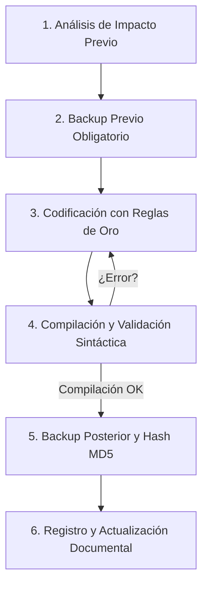

# Protocolo de Cambios Controlados y Buenas Prácticas — BDAS Multiusuario

> **Propósito:** Garantizar que cualquier modificación futura en el código VBA, en las hojas de Excel o en la base de datos Access se realice con riesgo cero de regresión, manteniendo la integridad referencial y documental en todo momento.

---

## 1. Recuperación y Verificación del Contexto Técnico del Proyecto

Antes de analizar cualquier incidencia o cambio, se debe recuperar y verificar el contexto técnico necesario a partir de los archivos, la documentación, los índices y los registros existentes del proyecto:

1. **Versión de referencia:** Identificar, cuando la información esté disponible, la versión de Git y el estado del código sobre el que se solicita trabajar. No presuponer que los archivos o fragmentos aportados corresponden a la última versión.
2. **Fuentes de información:** Consultar la documentación técnica, el inventario de componentes y el índice de dependencias existentes cuando sean pertinentes para la incidencia. El código fuente vigente será la referencia para comprobar nombres, implementaciones y relaciones reales.
3. **Identificación exacta:** Verificar los nombres y las referencias de los procedimientos, funciones, variables, formularios, controles, hojas, tablas, columnas y rangos implicados. No reconstruirlos de memoria ni a partir de documentación desactualizada.
4. **Contexto relevante:** Recuperar únicamente los componentes y antecedentes necesarios para comprender la incidencia, ampliando la inspección cuando las dependencias identificadas lo requieran.
5. **Información no disponible:** Si no se puede acceder a los archivos, verificar la versión o confirmar una dependencia crítica, indicarlo expresamente y solicitar únicamente la información imprescindible. No presentar como comprobados los datos que no hayan podido verificarse.
6. **Continuidad entre sesiones:** No presuponer que se recuerda íntegramente el código, las decisiones o las incidencias de conversaciones anteriores. Recuperar la información necesaria de las fuentes documentales y técnicas disponibles.
7. **Respeto del procedimiento vigente:** Esta recuperación y consulta de información no autoriza a modificar archivos, actualizar documentación, alterar el índice de dependencias ni ejecutar operaciones sobre Git, los respaldos o el Golden Master. Cualquier modificación de estos elementos seguirá sujeta a las autorizaciones y restricciones establecidas en las reglas permanentes.

> [!IMPORTANT]
> La recuperación y verificación del contexto es un requisito previo al diagnóstico, pero no sustituye el análisis de dependencias, la entrega de cambios exactos ni el procedimiento de validación establecidos a continuación.

---

## 2. El Ciclo de 6 Pasos para Modificaciones Seguras

Todo cambio solicitado al asistente o realizado por un desarrollador debe seguir estrictamente este flujo secuencial:



---

### PASO 1: Análisis de Impacto Previo
Antes de editar una sola línea de código:
1.  **Consultar [MAPA_DEPENDENCIAS.md](file:///H:/ResidenciaApp/docs/MAPA_DEPENDENCIAS.md):**
    *   Comprobar qué otros módulos invocan al procedimiento que se va a modificar.
    *   Verificar si el procedimiento es un callback del Ribbon (`onAction`) o un evento (`Worksheet_Change`, `Workbook_Open`).
    *   Revisar si la función interactúa con tablas de Access.
2.  **Consultar [DICCIONARIO_RANGOS.md](file:///H:/ResidenciaApp/docs/DICCIONARIO_RANGOS.md):**
    *   Verificar los CodeNames de las hojas involucradas (ej. `Hoja2` para Gijón, `Hoja24` para Oviedo).
    *   Tener presente la discrepancia de columnas (Gijón: 30 columnas, importe en `U`; Oviedo: 33 columnas, importe en `V`).
    *   Evitar alterar rangos nombrados o celdas maestras de tarifas e IVA.

---

### PASO 2: Copia de Seguridad Previa Obligatoria (`PRE`)
Antes de iniciar la edición:
1.  Generar una copia del libro activo en `H:\ResidenciaBD\BackupsDiarios`:
    *   Formato: `BDAS_Multiusuario_BACKUP_AAAA-MM-DD_HHMM_PRE_<DESCRIPCION>.xlsm`
2.  Si la tarea implica cambios estructurales en la base de datos Access, generar copia de seguridad de:
    *   `Residencia_BE_BACKUP_AAAA-MM-DD_HHMM_PRE_<DESCRIPCION>.accdb`

---

### PASO 3: Codificación Respetando las Reglas de Oro del Proyecto
Durante la edición en los archivos `.bas`, `.cls` o `.frm`, deben cumplirse sin excepción:

*   **Regla Estricta de Texto Literal `GIJÓN`:**  
    Usar siempre el texto literal `GIJÓN` (o `GIJON` en base de datos según el campo original). **Queda terminantemente prohibido el uso de `Chr(211)`, `ChrW(211)` o concatenaciones tipo `GIJ" & Chr(211) & "N`.**
*   **Fuente Única de Verdad (Access):**  
    Las altas, modificaciones y bajas de órdenes se realizan directamente en Access mediante `modDatabase`. La hoja Excel es únicamente una caché visual para impresión, filtros y calendarios. **No se utiliza doble escritura manual desincronizada.**
*   **Exclusividad de Borrado RGPD:**  
    El borrado físico de órdenes en Access (`DELETE FROM Ordenes`) queda reservado **de forma exclusiva** al panel RGPD ([ModuloRibbonRGPD.bas](file:///H:/ResidenciaApp/bdas-multiusuario/vba-modules/ModuloRibbonRGPD.bas)). Ninguna acción ordinaria de hoja (como pulsar `Supr` en un Nº de Orden) borrará datos de la base de datos; únicamente desvinculará o retirará la visualización local.
*   **Gestión Centralizada de Contraseñas:**  
    Ningún módulo nuevo o modificado debe contener contraseñas hardcodeadas en texto plano ni cuadros `InputBox` para solicitarlas. Toda contraseña se obtiene a través de [ModuloConfigSegura.bas](file:///H:/ResidenciaApp/bdas-multiusuario/vba-modules/ModuloConfigSegura.bas).
*   **Protección con `UserInterfaceOnly:=True`:**  
    Al proteger hojas operativas (`hoja.Protect password:=..., UserInterfaceOnly:=True`), se permite que el código VBA trabaje en segundo plano sin necesidad de continuas desprotecciones interactivas.

---

### PASO 4: Compilación y Validación Sintáctica Limpia
Una vez modificado el código e importado en el libro activo:
1.  Ejecutar el script de validación [Verify-VBA-Compile.vbs](file:///H:/ResidenciaApp/bdas-multiusuario/scripts/Verify-VBA-Compile.vbs).
2.  Comprobar que el proyecto compila sin errores de sintaxis, variables no declaradas (`Option Explicit`) o discrepancias de tipos.
3.  Si la macro toca fórmulas dinámicas (ej. tarifas), verificar que el recálculo arroja valores coherentes sin `#¡VALOR!` ni `#¿NOMBRE?`.

---

### PASO 5: Copia de Seguridad Posterior (`POST`) y Verificación de Hash
Una vez verificado el correcto funcionamiento:
1.  Guardar y cerrar el libro en uso.
2.  Generar la copia posterior:
    *   Formato: `BDAS_Multiusuario_BACKUP_AAAA-MM-DD_HHMM_POST_<DESCRIPCION>.xlsm`
3.  Sincronizar el archivo compartido de red en `H:\ResidenciaBD\BDAS_Multiusuario.xlsm`.
4.  Comprobar que el hash MD5 coincida entre la copia local y la réplica de red.

---

### PASO 6: Registro y Actualización Documental Obligatoria
Al finalizar la sesión o la tarea:
1.  Añadir el registro de la modificación en `docs/REGISTRO_CAMBIOS_AAAA-MM-DD.md`, indicando:
    *   Archivos de respaldo generados (`PRE` y `POST`).
    *   Motivo del cambio y solución implementada.
    *   Módulos modificados y pruebas realizadas.
2.  Si se han creado nuevos procedimientos, botones de Ribbon o rangos, actualizar de inmediato:
    *   [MAPA_DEPENDENCIAS.md](file:///H:/ResidenciaApp/docs/MAPA_DEPENDENCIAS.md)
    *   [DICCIONARIO_RANGOS.md](file:///H:/ResidenciaApp/docs/DICCIONARIO_RANGOS.md)

---

## 2. Protocolo de Contingencia y Reversión Inmediata (Rollback)

Si en algún momento una modificación genera un comportamiento anómalo o introduce errores no deseados, se aplicará el siguiente orden de reversión:

1.  **Reversión al Backup de la Sesión:**
    Restaurar de inmediato la copia previa generada en el Paso 2 (`..._PRE_...xlsm`).
2.  **Reversión a la Versión de Referencia Estable (Hito 2026-10-11):**
    Si el error persiste o se desconoce el alcance, ejecutar el script:
    ```powershell
    H:\ResidenciaApp\bdas-multiusuario\scripts\Restaurar-Version-Referencia.ps1
    ```
    *Este script restaura automáticamente la copia protegida en Solo Lectura que incluye el selector multirresidencia y el RibbonX dinámico verificado.*
3.  **Reversión Extrema al Golden Master:**
    Reservada exclusivamente para corrupciones graves de inicio de proyecto. Ejecutar:
    ```powershell
    H:\ResidenciaApp\bdas-multiusuario\scripts\Restaurar-Golden-Master.ps1
    ```
    *(Requiere confirmación expresa del usuario según las reglas del proyecto).*
