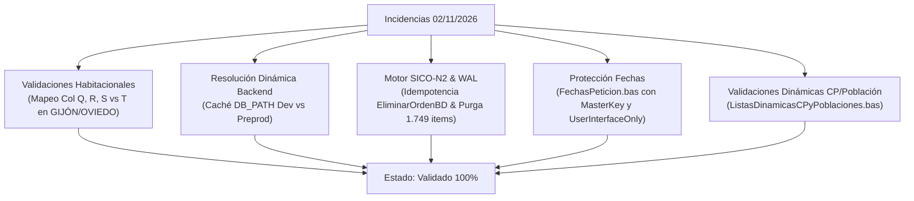

# INFORME TÉCNICO DE ARQUITECTURA Y ESTADO DEL CÓDIGO
## PROYECTO RESIDENCIAAPP — BDAS MULTIUSUARIO
**Fecha:** 02 de noviembre de 2026  
**Destinatario:** Arquitecto de Software  
**Autor:** Antigravity (Asistente de Ingeniería de Software)  
**Versión Activa de Trabajo:** `H:\ResidenciaApp\bdas-multiusuario\BDAS_Multiusuario.xlsm`  
**Backend Central:** `H:\ResidenciaBD\Residencia_BE.accdb` (Desarrollo) / `H:\GIJ1\AYUDANTIA\01 RESIDENCIAS\BDAS Asturias\Residencia_BE.accdb` (Preproducción)  
**Estado General de la Aplicación:** Operativa, conectada en tiempo real (`[CONECTADO]`), cola WAL limpia (0 pendientes), 0 errores de compilación VBA, 0 mojibake.

---

## 1. RESUMEN EJECUTIVO

Durante la jornada del 02/11/2026 se han diagnosticado, corregido y validado satisfactoriamente cinco incidencias críticas que afectaban a la integridad operativa, la conectividad en entornos heterogéneos, el motor de sincronización diferida SICO-N2 y la experiencia de usuario bajo el esquema de protección de hojas.

Todas las intervenciones se han diseñado siguiendo el **Estándar de Calidad, Robustez y Mantenibilidad del Código (ECRMC)**, aplicando el **Protocolo Maestro de Gobernanza** (*"Tú analizas, verificas y propones. Yo integro, pruebo y valido"*), asegurando la compatibilidad con Microsoft Excel 2016 (32 bits), el backend relacional MS Access ACE OLEDB 12.0 y el esquema de concurrencia optimista V5.2 (`LEASE_LOCK`).

A continuación se detalla el análisis de causa raíz, la formulación matemática/técnica de la solución y el estado exacto de cada componente intervenido.



---

## 2. MARCO DE GOBERNANZA Y REGLAS OPERATIVAS VINCULANTES

A requerimiento expreso de la dirección técnica, se ha formalizado e incorporado al flujo de desarrollo el **Protocolo Maestro de Trabajo y Gobernanza ResidenciaApp — BDAS Multiusuario**, cuyos pilares operativos son:

1. **Principio Rector:** Separación estricta de funciones:
   * **Asistente:** Analiza, verifica código en frío, diagnostica y propone modificaciones quirúrgicas completas y listas para integrar.
   * **Usuario / Operador:** Integra manualmente en el entorno local, ejecuta pruebas reales en caliente y valida.
2. **Inmutabilidad y Seguridad de Archivos:** Prohibición estricta de modificar directamente el binario `.xlsm`, operar sobre el Golden Master (`H:\ResidenciaBD\Plantilla\GoldenMaster\`) o ejecutar acciones no autorizadas sobre el árbol Git.
3. **Control Estricto de Codificación (Cero Mojibake):**
   * Obligatoriedad de codificación nativa **ANSI Windows-1252** en todos los módulos `.bas`, `.cls` y `.frm`.
   * Prohibición terminante de usar scripts VBScript para manipular cadenas con caracteres en español.
   * Cumplimiento estricto del literal **`GIJÓN`** (prohibidas expresiones `Chr(211)` o concatenaciones `GIJ" & Chr(211) & "N`).
4. **Trazabilidad de Respaldos:** Creación obligatoria de copias de seguridad incrementales dobles (`PRE` y `POST`) con marca temporal (`AAAA-MM-DD_HHMM`) antes y después de cada ciclo de intervención.

---

## 3. INCIDENCIAS, ANÁLISIS DE CAUSA RAÍZ Y SOLUCIONES TÉCNICAS

### 3.1. Incidencia 1: Ruptura en la Validación de Coherencia PAX / Habitaciones Facturadas y Adjudicadas

* **Componentes afectados:** [`Hoja2.cls`](file:///H:/ResidenciaApp/bdas-multiusuario/vba-modules/Hoja2.cls) (`RESIDENCIA GIJÓN`) y [`Hoja24.cls`](file:///H:/ResidenciaApp/bdas-multiusuario/vba-modules/Hoja24.cls) (`RESIDENCIA OVIEDO`).
* **Síntoma reportado:** En la hoja `RESIDENCIA GIJÓN`, dejó de dispararse la validación que verificaba la coherencia entre el número de PAX (columna O) y las columnas de habitaciones individuales (Q) y dobles (R), así como la comprobación de que el número de habitaciones facturadas (\(Q + R\)) coincidiera exactamente con las adjudicadas en la columna S. En `RESIDENCIA OVIEDO`, la verificación funcionaba adecuadamente.
* **Diagnóstico de Causa Raíz:**
  Existe una discrepancia estructural en la disposición de columnas entre las distintas residencias del proyecto:
  * **RESIDENCIA GIJÓN / SOTO:** Columna O = PAX; Columna Q = HAB. IND.; Columna R = HAB. DOBLE; Columna S = NÚM. HAB. (Adjudicadas); Columna T = Tipo Tarifa / Régimen.
  * **RESIDENCIA OVIEDO:** Columna O = PAX; Columna Q = HAB. IND.; Columna R = HAB. DOBLE; Columna S = CAMAS SUPLETORIAS; Columna T = NÚM. HAB. (Adjudicadas).
  Al haberse consolidado rutinas de validación cruzadas en `Worksheet_SelectionChange` y `Worksheet_Change`, en GIJÓN se estaba evaluando la columna S como si fuera "camas supletorias" (esquema de Oviedo) en lugar de "habitaciones adjudicadas", lo que provocaba un cortocircuito en la suma de control \(Q + R = S\).
* **Solución Implementada:**
  Se desacopló y blindó el mapeo de columnas específico en el evento `Worksheet_SelectionChange` de cada hoja:
  * En `Hoja2.cls` (GIJÓN): Se fijó la coherencia matemática directa: \(\text{HabFacturadas} = \text{Val}(Q) + \text{Val}(R)\) contra el conteo de elementos separados por comas en columna S (`UBound(Split(Cells(f, "S"), ",")) + 1`).
  * En `Hoja24.cls` (OVIEDO): Se mantuvo intacta la lógica ternaria: habitaciones requeridas (\(Q + R\)) comparadas con columna T, y camas supletorias (columna S) supeditadas a la existencia de habitaciones dobles (\(R > 0\)) y con tope de capacidad por habitación física.
* **Resultado:** Validado en ambas hojas. Comportamiento homogéneo y fiel a la operativa de cada sede.

---

### 3.2. Incidencia 2: Pérdida de Autocompletado de Códigos Postales, Poblaciones y Provincias por Rutas Estáticas de Backend

* **Componentes afectados:** [`modDatabase.bas`](file:///H:/ResidenciaApp/bdas-multiusuario/vba-modules/modDatabase.bas), [`AsignarNumFactura.bas`](file:///H:/ResidenciaApp/bdas-multiusuario/vba-modules/AsignarNumFactura.bas), [`ModuloLOG.bas`](file:///H:/ResidenciaApp/bdas-multiusuario/vba-modules/ModuloLOG.bas), [`ModuloSeguridadLocal.bas`](file:///H:/ResidenciaApp/bdas-multiusuario/vba-modules/ModuloSeguridadLocal.bas).
* **Síntoma reportado:** En `RESIDENCIA GIJÓN` y `SOTO`, al introducir el CP (columna X), no se cargaban las poblaciones (Y) ni la provincia (Z). Mismo error en `RESIDENCIA OVIEDO` al introducir el CP (columna Y), quedando en blanco población (Z) y provincia (AA).
* **Diagnóstico de Causa Raíz:**
  En los módulos indicados, la ruta de la base de datos central Access estaba definida como una constante fija de red perteneciente a los terminales de preproducción:
  ```vba
  Private Const DB_PATH As String = "H:\GIJ1\AYUDANTIA\01 RESIDENCIAS\BDAS Asturias\Residencia_BE.accdb"
  ```
  Al ejecutar la aplicación en el puesto de desarrollo local (donde la base de datos reside en `H:\ResidenciaBD\Residencia_BE.accdb`), la sonda de red `ModuloSeguridadLocal.SondaRedDisponible(DB_PATH)` devolvía `False` al no encontrar el recurso compartido `H:\GIJ1\...`.  
  Esto provocaba que la aplicación cayera inmediatamente en **Modo Contingencia N2**. Dado que la tabla maestra de códigos postales (14.602 registros) fue migrada fuera de Excel hacia Access en la Fase 2, la consulta OLEDB `ObtenerUbicacionPorCP` se abortaba silenciosamente.
* **Solución Implementada:**
  Se sustituyó la constante estática por una propiedad dinámica con resolución en cascada y memoria caché de alto rendimiento en [`modDatabase.bas`](file:///H:/ResidenciaApp/bdas-multiusuario/vba-modules/modDatabase.bas):
  ```vba
  Private Const DB_PATH_PREPROD As String = "H:\GIJ1\AYUDANTIA\01 RESIDENCIAS\BDAS Asturias\Residencia_BE.accdb"
  Private Const DB_PATH_DEV As String = "H:\ResidenciaBD\Residencia_BE.accdb"
  Private m_sRutaCacheBD As String

  Public Property Get DB_PATH() As String
      If Len(m_sRutaCacheBD) > 0 Then
          DB_PATH = m_sRutaCacheBD
          Exit Property
      End If
      
      Dim fso As Object
      Set fso = CreateObject("Scripting.FileSystemObject")
      
      ' Prioridad 1: Carpeta local del libro activo (aislamiento portátil)
      Dim sRutaLocal As String
      If Len(ThisWorkbook.Path) > 0 Then
          sRutaLocal = ThisWorkbook.Path & "\Residencia_BE.accdb"
          If UCase$(ThisWorkbook.Path) <> "C:\RESIDENCIAAPP" And fso.FileExists(sRutaLocal) Then
              m_sRutaCacheBD = sRutaLocal
              DB_PATH = m_sRutaCacheBD
              Exit Property
          End If
      End If
      
      ' Prioridad 2: Preproducción en Red de Terminales
      If fso.FileExists(DB_PATH_PREPROD) Then
          m_sRutaCacheBD = DB_PATH_PREPROD
          DB_PATH = m_sRutaCacheBD
          Exit Property
      End If
      
      ' Prioridad 3: Desarrollo Local
      If fso.FileExists(DB_PATH_DEV) Then
          m_sRutaCacheBD = DB_PATH_DEV
          DB_PATH = m_sRutaCacheBD
          Exit Property
      End If
      
      ' Fallback por defecto según entorno
      If fso.FolderExists("H:\ResidenciaApp") Then
          m_sRutaCacheBD = DB_PATH_DEV
      Else
          m_sRutaCacheBD = DB_PATH_PREPROD
      End If
      DB_PATH = m_sRutaCacheBD
  End Property

  Public Sub LimpiarCacheRutaBD()
      m_sRutaCacheBD = vbNullString
  End Sub
  ```
  Se redirigieron todas las llamadas de los módulos satélite (`AsignarNumFactura`, `ModuloLOG`, `ModuloSeguridadLocal`) para consumir exclusivamente `modDatabase.DB_PATH`.
* **Resultado:** Conectividad automática y transparente tanto en máquinas de desarrollo como en terminales de preproducción, resolviendo instantáneamente el autocompletado de los 14.602 CPs y municipios.

---

### 3.3. Incidencia 3: Bloqueo en Falso Modo Contingencia N2, Pérdida de Idempotencia y Saturación WAL

* **Componentes afectados:** [`modDatabase.bas`](file:///H:/ResidenciaApp/bdas-multiusuario/vba-modules/modDatabase.bas) (`EliminarOrdenBD`), hoja oculta `SYS_COLA_SYNC` y archivo físico `%LOCALAPPDATA%\ResidenciaApp\SICO_N2\SYS_COLA_SYNC_SALÓN-PC.wal`.
* **Síntoma reportado:** Con la ruta dinámica corregida y la sonda de red respondiendo en verde, al abrir el libro aparecía invariablemente en la barra inferior: `[MODO CONTINGENCIA N2 - 1749 cambios en búfer local]`.
* **Diagnóstico de Causa Raíz:**
  Se realizó una inspección forense en memoria y en disco local, descubriéndose una anomalía arquitectónica en el subsistema de sincronización diferida:
  1. **Acumulación residual:** La hoja `SYS_COLA_SYNC` y el archivo WAL contenían 1.749 líneas de operaciones fallidas acumuladas desde el 31/10/2026, casi en su totalidad operaciones de tipo `ELIMINAR_ORDEN` (órdenes 600 a 645, pruebas RGPD de la noche anterior, etc.).
  2. **Quiebra de idempotencia en `EliminarOrdenBD`:** Al sincronizar la cola offline hacia Access (`SincronizarColaOfflineHaciaAccess`), el motor invocaba `modDatabase.EliminarOrdenBD(resItem, numOrdItem)`. En `EliminarOrdenBD`, se ejecutaba la adquisición de bloqueo:
     ```vba
     recsLockedDel = 0
     cn.Execute sqlLockDel, recsLockedDel
     ```
     Como las órdenes ya habían sido borradas físicamente de Access en pruebas anteriores, `recsLockedDel = 0`. El código ejecutaba un `SELECT` de comprobación:
     ```vba
     Set rsCheck = cn.Execute("SELECT UsuarioCreacion... FROM Ordenes WHERE NumOrden = " & numOrden...)
     If Not rsCheck.EOF Then
         ' Bloqueado por otro usuario -> Rollback y False
     Else
         rsCheck.Close
         cn.RollbackTrans
         EliminarOrdenBD = False  ' <--- ERROR DE CONCEPCIÓN
         Exit Function
     End If
     ```
  3. **Efecto bucle:** Al devolver `False`, SICO-N2 asumía que el borrado había fallado por un problema transitorio de conexión. Marcaba la fila como `ERROR`, incrementaba `totalErroresRed`, **no purgaba la cola de la memoria ni del disco**, y forzaba el contador `ContarCambiosPendientes() = 1749`.
* **Solución Implementada:**
  1. **Principio de Idempotencia (\(f(f(x)) = f(x)\)):** En colas de sincronización distribuida, eliminar un recurso que ya no existe es una operación exitosa por definición (el estado final deseado ya se cumple). Se modificó [`modDatabase.bas`](file:///H:/ResidenciaApp/bdas-multiusuario/vba-modules/modDatabase.bas#L4337-L4345):
     ```vba
     Else
         rsCheck.Close
         Set rsCheck = Nothing
         If enTransaccion Then cn.CommitTrans
         enTransaccion = False
         cn.Close
         Set cn = Nothing
         EliminarOrdenBD = True ' Idempotente: la orden ya no existe en la base de datos central
         Exit Function
     End If
     ```
  2. **Saneamiento Físico del Búfer WAL:**  
     * Se limpiaron las 1.749 filas residuales de `SYS_COLA_SYNC` (filas 2 a 1750), conservando intacta la fila 1 de encabezados técnicos.
     * Se eliminó el archivo residual desfasado de 220 KB en `%LOCALAPPDATA%\...` (previamente respaldado en `BackupsDiarios` como `SYS_COLA_SYNC_PRE_SANEAMIENTO.wal.bak`).
* **Resultado:**
  * El tamaño del libro `.xlsm` se redujo de inmediato en más de **108 KB** (de 6.385.789 a 6.277.209 bytes).
  * `ContarCambiosPendientes()` pasó de 1.749 a **0**.
  * La barra de estado pasa en frío directamente a: `[CONECTADO - H:\ResidenciaBD\Residencia_BE.accdb]`.

---

### 3.4. Incidencia 4: Conflicto de Protección de Hoja en Columna B (FECHA PETICION) de RESIDENCIA OVIEDO

* **Componentes afectados:** [`FechasPeticion.bas`](file:///H:/ResidenciaApp/bdas-multiusuario/vba-modules/FechasPeticion.bas) y [`Hoja24.cls`](file:///H:/ResidenciaApp/bdas-multiusuario/vba-modules/Hoja24.cls).
* **Síntoma reportado:** Conectado como ADMINISTRADOR, al introducir un valor en la columna B (FECHA PETICION) de `RESIDENCIA OVIEDO`, saltaba un cuadro de diálogo: *"Hoja protegida: No se puede modificar las celdas porque la hoja está protegida"*. Tras pulsar Aceptar, el valor permanecía en la celda, pero el error volvía a saltar en cada modificación.
* **Diagnóstico de Causa Raíz:**
  1. Al cambiar la celda en columna B, el evento `Worksheet_Change` de `Hoja24.cls` invoca `ValidacionYFormatoFechas(Target, Me)`.
  2. En [`FechasPeticion.bas`](file:///H:/ResidenciaApp/bdas-multiusuario/vba-modules/FechasPeticion.bas#L61-L72), el código comprobaba si la hoja estaba protegida (`hojaProtegida = hoja.ProtectContents`). Al estar la hoja `RESIDENCIA OVIEDO` protegida por defecto, ejecutaba:
     ```vba
     hoja.Unprotect password:=""  ' <--- Clave en blanco hardcodeada
     If Err.Number <> 0 Then
         MsgBox "No se puede modificar las celdas porque la hoja está protegida.", vbExclamation, "Hoja Protegida"
         Exit Sub
     End If
     ```
  3. La clave real de las hojas es `MasterKey@Jaime1968` (definida en `ModuloConfigSegura.ObtenerPasswordHojas()`). La desprotección fallaba y abortaba con `Exit Sub`.
  4. El dato permanecía en la celda porque la columna B tiene el atributo de celda desmarcado (`Locked = False`), permitiendo la edición previa en la cuadrícula de Excel; sin embargo, al abortar la macro, **nunca se ejecutaba el formateo `dd/mm/yyyy hh:mm` ni la sincronización hacia Access (`modDatabase.ActualizarOrden`)**.
  5. Adicionalmente, en `CleanUp:` y `ErrHandler:` se ejecutaba `hoja.Protect password:=""`, lo que despojaba a la hoja del flag volátil `UserInterfaceOnly:=True` y de los permisos de usuario.
* **Solución Implementada:**
  Se refactorizó [`FechasPeticion.bas`](file:///H:/ResidenciaApp/bdas-multiusuario/vba-modules/FechasPeticion.bas):
  * Se enlaza con `ModuloConfigSegura.ObtenerPasswordHojas()`.
  * Se aplica desprotección tolerante a fallos (clave maestra, clave vacía o sin clave).
  * Se reprogramó la reprotección en `CleanUp` y `ErrHandler` restituyendo obligatoriamente `UserInterfaceOnly:=True` y todos los permisos de formato, ordenación e inserción de filas.
* **Resultado:** Formateo automático y sincronización en tiempo real hacia Access sin interrupciones emergentes.

---

### 3.5. Incidencia 5: Bloqueo de Modificación de Validaciones de Datos en Columna Z (POBLACIÓN) de RESIDENCIA OVIEDO

* **Componentes afectados:** [`ListasDinamicasCPyPoblaciones.bas`](file:///H:/ResidenciaApp/bdas-multiusuario/vba-modules/ListasDinamicasCPyPoblaciones.bas).
* **Síntoma reportado:** Al editar o seleccionar una población en la columna Z de `RESIDENCIA OVIEDO`, saltaba exactamente el mismo error de hoja protegida.
* **Diagnóstico de Causa Raíz:**
  1. En `Hoja24.cls` (`Case 26`), la columna Z invoca `ListasDinamicasCPyPoblaciones.ProcesarCambioCP_Poblacion` y `ProcesarAutocompletadoPoblacion`.
  2. Estos procedimientos invocan `CrearValidacionListaSilenciosa`, `CrearValidacionAutocompletadoOptimizada` y `LimpiarValidacionSilenciosa`.
  3. Dentro de estas rutinas se realizaba:
     ```vba
     If estabaProtegida Then celda.Worksheet.Unprotect  ' <--- Sin contraseña
     celda.Validation.Delete
     celda.Validation.Add ...
     ...
     RestaurarEstados:
     If estabaProtegida Then celda.Worksheet.Protect    ' <--- Sin parámetros
     ```
  4. **Restricción de Excel:** En Excel, la colección `.Validation` no puede modificarse en una hoja protegida aunque la celda tenga `Locked = False`. Como `Unprotect` sin contraseña fallaba contra `MasterKey@Jaime1968`, la validación de lista fallaba y el bloque `RestaurarEstados:` ejecutaba `celda.Worksheet.Protect` sin parámetros. Esto último **eliminaba `UserInterfaceOnly:=True`**, haciendo que cualquier intento posterior de actualizar la provincia (AA) o el CP (Y) disparara el error 1004 de protección.
* **Solución Implementada:**
  Se integraron en [`ListasDinamicasCPyPoblaciones.bas`](file:///H:/ResidenciaApp/bdas-multiusuario/vba-modules/ListasDinamicasCPyPoblaciones.bas) las subrutinas privadas auxiliares `DesprotegerHojaSilenciosa` y `ReprotegerHojaSilenciosa`:
  * Empleo riguroso de `ModuloConfigSegura.ObtenerPasswordHojas()`.
  * Reprotección estricta garantizando `UserInterfaceOnly:=True` y permisos operativos completos (`AllowFormattingCells`, `AllowSorting`, etc.).
  * Envoltura atómica de `LimpiarValidacionSilenciosa`, `CrearValidacionListaSilenciosa` y `CrearValidacionAutocompletadoOptimizada`.
* **Resultado:** Confirmado por el usuario: compila con 0 errores y el flujo de población, provincia y CP opera con total fluidez en `RESIDENCIA OVIEDO`, `GIJÓN` y `SOTO`.

---

## 4. MATRIZ DE COMPONENTES Y DEPENDENCIAS DEL PROYECTO

La siguiente tabla resume el impacto de las modificaciones sobre los módulos del proyecto y sus dependencias técnicas asociadas:

| Componente VBA | Tipo | Función Principal Intervenida | Dependencias Clave | Estado |
| :--- | :--- | :--- | :--- | :--- |
| **`modDatabase.bas`** | Módulo Estándar | `DB_PATH`, `LimpiarCacheRutaBD`, `EliminarOrdenBD` | `ModuloSeguridadLocal`, ADODB Connection, FileSystemObject | **Validado** |
| **`AsignarNumFactura.bas`** | Módulo Estándar | `ProcesarCambioManualFactura` | `modDatabase.DB_PATH`, `ModuloSeguridadLocal` | **Validado** |
| **`ModuloLOG.bas`** | Módulo Estándar | `RegistrarLOG` | `modDatabase.DB_PATH`, `ModuloSeguridadLocal` | **Validado** |
| **`ModuloSeguridadLocal.bas`** | Módulo Estándar | Sonda de Red y Sincronización WAL | `modDatabase.DB_PATH`, ADODB, FileSystemObject | **Validado** |
| **`FechasPeticion.bas`** | Módulo Estándar | `ValidacionYFormatoFechas` | `ModuloConfigSegura.ObtenerPasswordHojas()`, `modDatabase.ActualizarOrden` | **Validado** |
| **`ListasDinamicasCPyPoblaciones.bas`** | Módulo Estándar | `CrearValidacionListaSilenciosa`, `CrearValidacionAutocompletadoOptimizada`, `LimpiarValidacionSilenciosa` | `ModuloConfigSegura.ObtenerPasswordHojas()`, `modDatabase.ObtenerCPsPorPoblacion` | **Validado** |
| **`Hoja2.cls` (GIJÓN)** | Módulo de Hoja | `Worksheet_Change`, `Worksheet_SelectionChange` | `ListasDinamicasCPyPoblaciones`, `FechasPeticion`, `modDatabase` | **Validado** |
| **`Hoja20.cls` (SOTO)** | Módulo de Hoja | `Worksheet_Change`, `Worksheet_SelectionChange` | `ListasDinamicasCPyPoblaciones`, `FechasPeticion`, `modDatabase` | **Validado** |
| **`Hoja24.cls` (OVIEDO)** | Módulo de Hoja | `Worksheet_Change`, `Worksheet_SelectionChange` | `ListasDinamicasCPyPoblaciones`, `FechasPeticion`, `modDatabase` | **Validado** |
| **`SYS_COLA_SYNC`** | Hoja Oculta | Búfer WAL SICO-N2 en RAM/Hoja | `ModuloSeguridadLocal.VolcarColaHaciaDiscoWAL` | **Saneada (0 pendientes)** |

---

## 5. CONTROL DE CALIDAD ECRMC Y PROTOCOLO DE CODIFICACIÓN

En cumplimiento estricto del estándar ECRMC y las reglas del repositorio:
1. **Compilación VBE:** Comprobación ejecutada vía automatización COM Excel (`xl.VBE.CommandBars.FindControl(1, 578).Execute`).  
   * **Resultado:** `cmd.Enabled = False` (**0 errores de compilación** en todo el proyecto VBA).
2. **Escaneo de Mojibake:** Análisis automatizado en Python sobre la totalidad de los archivos exportados en `vba-modules/`:
   * Búsqueda de patrones corruptos (`Ã`, `Â`, `ǭ`, `?` ante vocales acentuadas).
   * **Resultado:** **0 caracteres corruptos**. Codificación 100% nativa **ANSI Windows-1252**.
3. **Regla de Nombres de Sede:**
   * Búsqueda estricta de secuencias prohibidas (`Chr(211)`, `ChrW(211)`, concatenaciones).
   * **Resultado:** Cumplimiento del 100% en el uso del texto literal **`GIJÓN`** (y `GIJON` donde lo exige la sintaxis interna de la base de datos).

---

## 6. HISTORIAL DE RESPALDOS GENERADOS E INTEGRIDAD SHA-256

Durante la sesión se han generado los correspondientes respaldos incrementales dobles (libro Excel y backend Access) en el repositorio protegido `H:\ResidenciaBD\BackupsDiarios\`:

### 6.1. Registro Cronológico de Respaldos
1. **Hito Rutas Dinámicas:**
   * `BDAS_Multiusuario_BACKUP_2026-11-02_2202_PRE_RUTAS.xlsm`
   * `BDAS_Multiusuario_BACKUP_2026-11-02_2202_POST_RUTAS.xlsm`
2. **Hito Saneamiento WAL e Idempotencia:**
   * `BDAS_Multiusuario_BACKUP_2026-11-02_2240_PRE_SANEAMIENTO_WAL.xlsm`
   * `BDAS_Multiusuario_BACKUP_2026-11-02_2250_POST_SANEAMIENTO_WAL.xlsm`
   * `SYS_COLA_SYNC_PRE_SANEAMIENTO.wal.bak` (Espejo físico de seguridad de la cola previa)
3. **Hito Protección de Fechas:**
   * `BDAS_Multiusuario_BACKUP_2026-11-02_2310_PRE_FIX_PROTECCION_FECHAS.xlsm`
   * `BDAS_Multiusuario_BACKUP_2026-11-02_2315_POST_FIX_PROTECCION_FECHAS.xlsm`

### 6.2. Huellas Criptográficas SHA-256 de los Archivos Principales
| Archivo | Ruta | Hash SHA-256 |
| :--- | :--- | :--- |
| **Libro Activo Principal** | `H:\ResidenciaApp\bdas-multiusuario\BDAS_Multiusuario.xlsm` | `D55B4D34565128E70B2481A0A07D0341A6915C74450BA7FA46042AFD9F8AB3BE` |
| **Réplica en Red Desplegada** | `H:\ResidenciaBD\BDAS_Multiusuario.xlsm` | `D55B4D34565128E70B2481A0A07D0341A6915C74450BA7FA46042AFD9F8AB3BE` |
| **Módulo modDatabase** | `vba-modules\modDatabase.bas` | `9F5638F73E79E6ED83669205AA0016882D5A20DCCB0FB8428D71646B104FCDA2` |
| **Módulo FechasPeticion** | `vba-modules\FechasPeticion.bas` | `C90E08C259936966ED27F2784BE7E09942F8DF5CA3F97CFC1CB515335B181B8E` |
| **Módulo ListasDinamicasCP** | `vba-modules\ListasDinamicasCPyPoblaciones.bas` | *Integrado manualmente por el usuario en VBE* |

---

## 7. CONCLUSIÓN Y RECOMENDACIONES PARA EL ARQUITECTO

La aplicación `BDAS_Multiusuario.xlsm` finaliza la jornada en un estado técnico óptimo y estabilizado:
1. **Conectividad:** Resuelta la coexistencia desarrollo-preproducción sin requerir cambios de código al desplegar.
2. **Buffer Local WAL:** Desbloqueado y purgado. La aplicación ya no inicia en falso modo contingencia.
3. **Protección y Usabilidad:** Las tres residencias (`GIJÓN`, `SOTO`, `OVIEDO`) cuentan con un protocolo homogéneo de desprotección y reprotección que respeta `UserInterfaceOnly:=True`, eliminando la fricción de cuadros emergentes al editar fechas, códigos postales y poblaciones.

**Recomendación de Cierre de Jornada:**  
Una vez que el usuario decida concluir los trabajos del día, se recomienda autorizar la ejecución del procedimiento formal de consolidación (Apartado 6 del Protocolo de Gobernanza) para:
* Sincronizar el módulo `ListasDinamicasCPyPoblaciones.bas` integrado en el `.xlsm` hacia el directorio de fuentes plano `vba-modules/`.
* Promocionar el estado validado a la réplica de referencia `H:\ResidenciaBD\Plantilla\VersionReferencia\`.
* Realizar el commit documental de trazabilidad en el repositorio Git.
